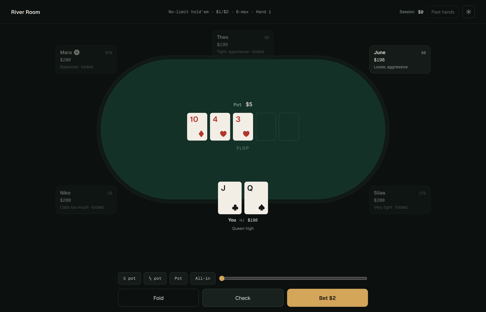

# River Room

A six-max $1/$2 no-limit hold'em practice table that runs locally. You play against five bots that each have a different style, then read a plain-language review of every decision you made. Training chips only; nothing is saved off your device.

<!-- Screenshot: add docs/table.png and docs/review.png, then embed them here. -->


## Run it

Requires Node.js 22.13 or newer.

```sh
npm install
npm run dev        # http://localhost:3000
```

During a hand: `F` fold, `C` check or call, `R` bet or raise, `5` / `7` / `P` / `A` for ½ pot, ⅔ pot, pot and all-in. After a hand: `N` deal the next hand, `V` open or close the review. The settings menu (gear icon) lists these, and holds pace, dollars or big blinds, pause and reset. The session is stored in your browser's local storage.

```sh
npm run typecheck && npm run lint
npm run test:unit    # engine, review prose, worker and coach tests
npm test             # production build, server render, unit tests, style bands, coach benchmark
```

## How the opponents and the review work

**Opponents.** Each seat plays one of five styles, shown under the player's name: Mara is balanced, Theo is tight and aggressive, June is loose and aggressive, Silas is very tight, and Niko calls too much. Every style sits on the same base policy and adds a few readable habits, such as June firing again on scare cards or Silas folding to a second bet without a strong hand. `npm run style:report` plays thousands of bots-only hands and prints how each one actually plays, and `npm run test:style` fails if any style drifts outside its advertised bands. Bots only ever see their own cards and public information.

**Review.** After a hand, every decision you made is evaluated. The coach estimates your equity against the hands each opponent plausibly holds, compares the legal options by expected value, and `app/engine/explain.ts` turns that into a verdict, a short explanation and a ranked list of options. Opponents' cards are shown after the hand, but never change the grade: a decision is judged on what you could know. The evaluations come from River Room's built-in model, not a solver.

Details for contributors: [RULES.md](RULES.md) covers the supported game (blinds, rake, side pots), [CLAUDE.md](CLAUDE.md) holds the maintenance conventions, and [benchmarks/README.md](benchmarks/README.md) covers the bot gate, style report and coach validation.

## Code map

- `app/poker-engine.ts` re-exports `app/engine/*`, layered so lower modules never import higher ones: `types` → `cards` → `rules` → `board`, `profiles`, `context` → `preflop` → `ranges` → `evaluation` → `bots` → `coach` → `game`, with `persistence` beside `rules`. `explain` and `timeline` only read finished hands and reviews.
- `app/PokerTable.tsx`, `app/components/*`, `app/globals.css`: the table, the review page and the settings menu.
- `app/poker.worker.ts`, `app/usePokerEngine.ts`: bot decisions and coaching run in a worker, with timeout recovery.
- `app/useSavedSession.ts`: debounced local-storage saves (`HandState` version 9) and preferences.
